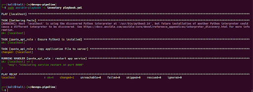
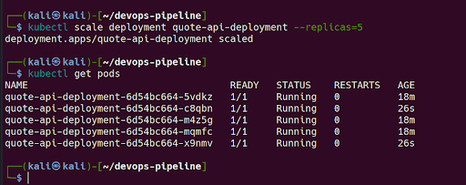
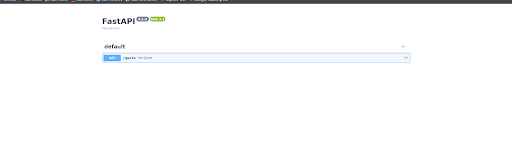

# End-to-End DevOps CI/CD Pipeline for FastAPI Quote Service

An automated, production-style Continuous Integration and Continuous Deployment (CI/CD) pipeline built to test, provision, containerize, and orchestrate a [Python](https://docs.python.org/3/tutorial/index.html) [FastAPI](https://fastapi.tiangolo.com/tutorial/) microservice. This project demonstrates how code changes move from a [Git](https://git-scm.com/) repository through automated unit testing in [Jenkins](https://www.jenkins.io/doc/book/pipeline/), host configuration management with [Ansible](https://docs.ansible.com/projects/ansible/latest/collections/index_module.html), containerization via [Docker](https://docs.docker.com/get-started/docker-overview/), and resilient, horizontally scaled deployment on a local [Minikube](https://minikube.sigs.k8s.io/docs/start/) [Kubernetes](https://kubernetes.io/docs/concepts/workloads/controllers/deployment/) cluster.

## Technologies Used

The pipeline integrates industry-standard DevOps tools across each stage of the software delivery lifecycle:

| Category | Technology | Role in Pipeline |
| :--- | :--- | :--- |
| **Application & Testing** | [Python 3](https://docs.python.org/3/tutorial/index.html) & [FastAPI](https://fastapi.tiangolo.com/tutorial/) | High-performance REST API framework serving random quotes at the `/quote` endpoint and interactive OpenAPI documentation at `/docs`. |
| **Unit Testing** | [Pytest](https://docs.pytest.org/en/stable/getting-started.html) | Automated testing framework used to validate API responses and ensure code integrity before deployment. |
| **Source Control** | [Git](https://git-scm.com/) & [GitHub](https://docs.github.com/actions/guides/building-and-testing-python) | Distributed version control system and remote repository hosting source code, playbooks, and Kubernetes manifests (`~/devops-pipeline`). |
| **Continuous Integration (CI)** | [Jenkins](https://www.jenkins.io/doc/book/pipeline/) | Automation server triggered by GitHub pushes to build isolated virtual environments, install dependencies, and execute the test suite. |
| **Configuration Management (CD)** | [Ansible](https://docs.ansible.com/projects/ansible/latest/collections/index_module.html) | Agentless provisioning tool executing role-based tasks (`quote_api_role`) and idempotent handlers to configure the host server. |
| **Containerization** | [Docker](https://docs.docker.com/get-started/docker-overview/) | Container runtime packaging the FastAPI application and its dependencies into a portable, reproducible image. |
| **Container Orchestration** | [Kubernetes](https://kubernetes.io/docs/concepts/workloads/controllers/deployment/) & [Minikube](https://minikube.sigs.k8s.io/docs/start/) | Local Kubernetes cluster orchestrating container scheduling, self-healing [Liveness Probes](https://kubernetes.io/docs/tasks/configure-pod-container/configure-liveness-readiness-startup-probes/), [ReplicaSet](https://kubernetes.io/docs/concepts/workloads/controllers/replicaset/) scaling, and [NodePort Service](https://kubernetes.io/docs/concepts/services-networking/service/) networking. |

## Pipeline Workflow

The delivery mechanism operates in five sequential stages, taking code from a developer commit to a load-balanced Kubernetes cluster:

### 1. Application Layer
The core service is a lightweight [FastAPI](https://fastapi.tiangolo.com/tutorial/) web application (`FastAPI 0.1.0`, OpenAPI `3.1`) that exposes a `GET /quote` endpoint returning random quotes, alongside built-in Swagger UI documentation at `/docs` and the schema at `/openapi.json`.

### 2. Continuous Integration (CI) with Git, GitHub, and Jenkins
- **Version Control Trigger**: Developers commit and push application code and pipeline configurations to the remote [GitHub](https://docs.github.com/actions/guides/building-and-testing-python) repository.
- **Automated Build & Isolation**: The repository push automatically triggers a [Jenkins](https://www.jenkins.io/doc/book/pipeline/) job, which provisions a clean [Python](https://docs.python.org/3/tutorial/index.html) virtual environment (`venv`) and installs all required packages.
- **Automated Quality Gate**: Jenkins runs unit tests via [Pytest](https://docs.pytest.org/en/stable/getting-started.html) to verify endpoint behavior and code integrity. Only builds that pass all unit tests proceed downstream.

### 3. Configuration Management with Ansible
- **Host Provisioning**: An [Ansible](https://docs.ansible.com/projects/ansible/latest/collections/index_module.html) playbook (`playbook.yml`) is executed against the target inventory (`sudo ansible-playbook -i inventory playbook.yml`) using the dedicated `quote_api_role`.
- **Task Execution**: The role gathers host facts, ensures `python3` is installed on the target machine, and copies the latest application files to the server.
- **Idempotent Service Handlers**: When application files change, Ansible triggers the `restart app service` handler (simulating a service restart on port `8000`). Because handlers only run when a task reports a `changed` state, repeated runs remain strictly idempotent.

### 4. Containerization & Kubernetes Orchestration
- **Docker Packaging**: The verified FastAPI application is packaged into a [Docker](https://docs.docker.com/reference/dockerfile/) container image so it runs consistently across environments.
- **Cluster Deployment**: The container image is deployed to a local [Minikube](https://minikube.sigs.k8s.io/docs/start/) cluster using declarative Kubernetes manifests:
  * **Deployment (`quote-api-deployment`)**: Manages the desired state of the application pods and oversees the underlying [ReplicaSet](https://kubernetes.io/docs/concepts/workloads/controllers/replicaset/).
  * **NodePort Service**: Exposes the internal pod network to external traffic on a static node port so users and external tools can reach the API.

### 5. Enhancements & Horizontal Scaling
- **Self-Healing Monitoring**: The Kubernetes [Deployment](https://kubernetes.io/docs/concepts/workloads/controllers/deployment/) configures an HTTP `GET` [Liveness Probe](https://kubernetes.io/docs/tasks/configure-pod-container/configure-liveness-readiness-startup-probes/) targeting the `/docs` endpoint to continuously verify container responsiveness.
- **Horizontal Pod Scaling**: To handle increased traffic and demonstrate high availability, the deployment is dynamically scaled up to **5 replica pods** (`kubectl scale deployment quote-api-deployment --replicas=5`), distributing incoming requests across all active instances.

## Key Enhancements

### Automated Pre-Deployment Validation with Pytest
Integrating [Pytest](https://docs.pytest.org/en/stable/getting-started.html) directly into the [Jenkins](https://www.jenkins.io/doc/book/pipeline/) CI pipeline shifts quality assurance left. Every commit is validated inside an isolated virtual environment before any infrastructure provisioning or container build takes place. If a change breaks the `/quote` endpoint contract or introduces a syntax regression, the pipeline fails fast and prevents broken artifacts from reaching the target host or Kubernetes cluster.

### Self-Healing Infrastructure with Kubernetes Liveness Probes
Container processes can occasionally hang or enter a deadlocked state without crashing the underlying process. By configuring an HTTP `GET` [Liveness Probe](https://kubernetes.io/docs/concepts/workloads/pods/probes/) against the FastAPI `/docs` endpoint:
- The `kubelet` periodically sends an HTTP `GET` request to `/docs` on the container port.
- As long as FastAPI returns a `200 OK` status, the pod remains marked healthy.
- If the endpoint stops responding and exceeds the failure threshold, Kubernetes automatically terminates and restarts the unhealthy container, maintaining uptime without manual intervention.

## Execution Results

### 1. Ansible Playbook Execution
Running `sudo ansible-playbook -i inventory playbook.yml` provisions `localhost` using `quote_api_role`, verifies the Python 3 installation, copies the updated application file, and triggers the `restart app service` handler on port `8000` with zero failures (`ok=4 changed=1 unreachable=0 failed=0`):

### 2. Kubernetes Horizontal Scaling to 5 Replicas
Executing `kubectl scale deployment quote-api-deployment --replicas=5` followed by `kubectl get pods` confirms that the ReplicaSet scaled the application to 5 healthy, concurrent pods (`1/1 Running` with `0` restarts):

### 3. FastAPI Swagger UI & Working `/quote` Endpoint
Accessing the exposed Kubernetes service in the browser loads the interactive [FastAPI](https://fastapi.tiangolo.com/tutorial/) Swagger UI (`/docs`), displaying the `GET /quote` endpoint ready for live testing:

